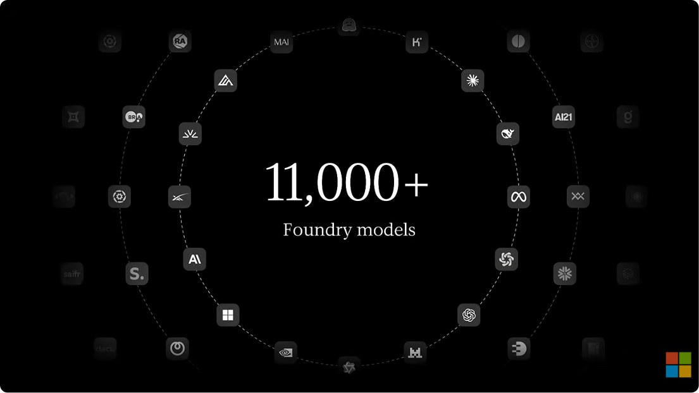
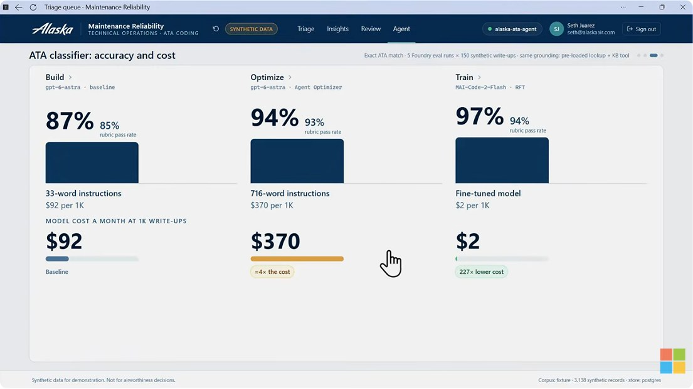
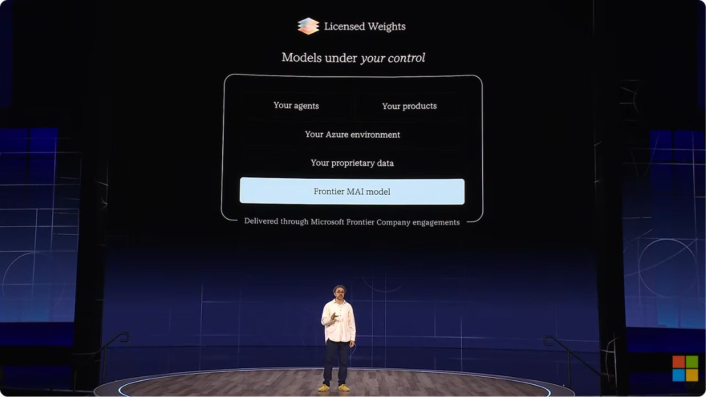
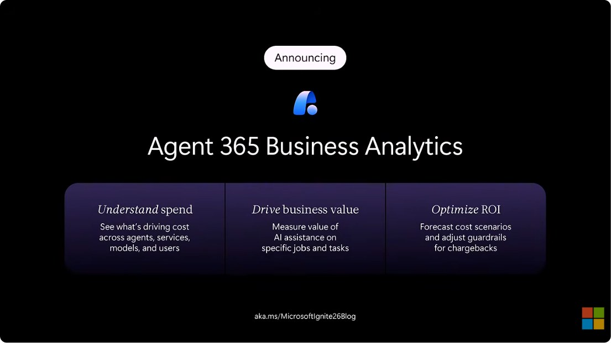
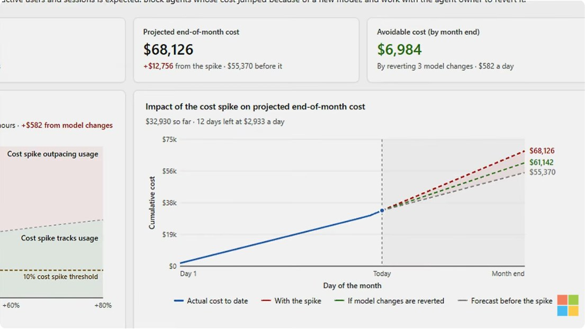
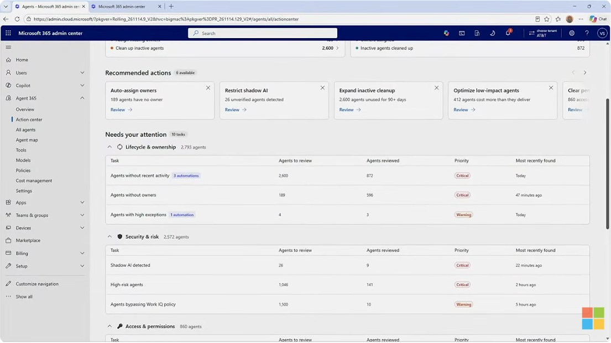
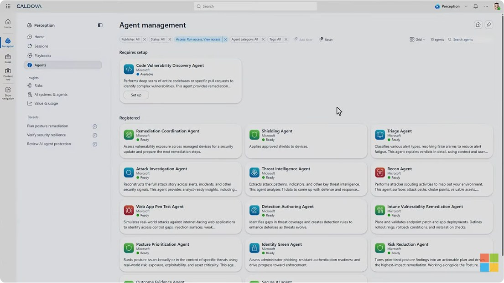
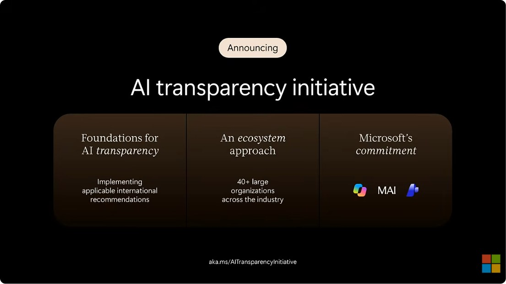

Microsoft Ignite 2026 오프닝 키노트의 핵심 내용을 정리했습니다. 

상세 내용은 아래 동영상에서 확인하실 수 있습니다.

> **먼저 알아두면 좋은 용어**
> - **에이전트**: 사람이 일일이 시키지 않아도 목표를 받아 스스로 일을 진행하는 AI입니다.
> - **플러그인**: Copilot에 붙여서 쓰는 추가 기능입니다. 영업 시스템을 연결하면 Copilot이 영업 업무를 도와줍니다.
> - **크레딧**: AI를 쓴 만큼 차감되는 사용량 단위입니다. 이 글의 예시에서는 10,000 크레딧이 약 100달러입니다.
> - **가중치**: AI 모델이 학습한 내용이 담긴 핵심 데이터입니다. 가중치를 가지고 있으면 그 모델을 직접 조정하고 운영할 수 있습니다.
> - **파인튜닝**: 이미 만들어진 AI 모델에 회사의 데이터를 추가로 학습시켜서 우리 업무에 맞게 다듬는 작업입니다.

## 이번 키노트의 큰 주제

| # | 주제 | 한 줄 요약 | 대표 고객 사례 |
|---|---|---|---|
| 1 | Frontier Ecosystem | AI는 모델 하나가 아니라 사람, 지능, 신뢰가 함께 갖춰져야 성과를 낸다 | - |
| 2 | Microsoft 365 Copilot | Copilot이 채팅 도구에서 업무용 운영체제로 확장된다 | Chevron, BlackRock, Accenture |
| 3 | Microsoft IQ | 회사의 지식과 판단 기록을 모아 모든 에이전트가 함께 쓴다 | Unilever |
| 4 | Foundry | 에이전트를 만들고, 운영하고, 쓸수록 더 낫게 만든다 | Alaska Airlines |
| 5 | 모델과 MAI | 상황에 맞는 모델을 고르고, 우리 데이터로 직접 만든 모델을 소유한다 | AT&T, Adobe, Epic, Dragon |
| 6 | AI 비용 관리 | AI에 얼마를 쓰고 무엇을 얻었는지 설명할 수 있어야 한다 | AT&T |
| 7 | 에이전트 관리 (Agent 365) | 직원을 관리하듯 에이전트도 등록하고, 권한을 주고, 정리한다 | AT&T |
| 8 | 보안 (Perception) | 공격이 AI로 빨라졌으니 방어도 에이전트로 맞선다 | BNY |
| 9 | AI 투명성 이니셔티브 | 자체적으로 만든 AI를 외부에서 검증할 수 있게 한다 | - |
| 10 | 인프라 | 에이전트가 쏟아내는 속도를 받쳐주는 인프라 구축한다 | GitHub |
| 11 | 사람과 조직의 변화 | 기술보다 일하는 방식을 바꾸는 것이 더 어렵다 | Publicis |

## 1. Frontier Ecosystem: 키노트 전체의 뼈대

사티아 나델라는 AI를 잘 쓰려면 성능 좋은 모델 하나가 아니라, 아래 세 가지가 함께 갖춰진 **Frontier Ecosystem**이 필요하다고 설명했습니다. 이후 발표는 모두 이 세 가지 중 하나에 해당합니다.

| 구분 | 쉽게 말하면 | 이어지는 주제 |
|---|---|---|
| Human ambition (사람) | AI는 사람을 대신하는 것이 아니라 사람이 하려는 일을 더 크게 해주는 도구입니다. 일하는 방식은 달라져도 사람의 경험과 전문성은 여전히 중요합니다. | 2, 11 |
| Intelligence (지능) | 기업이 자신만의 지식과 노하우를 직접 쌓고 소유해야 합니다. 몇몇 AI 모델에만 모든 것을 맡기면 기업의 경쟁력이 사라질 수 있습니다. | 3, 4, 5 |
| Trust (신뢰) | AI가 내부에서 어떻게 판단하는지는 완전히 알기 어렵습니다. 그래서 AI가 "문제없다"고 말하는 것을 믿는 대신, 회사가 AI에게 줄 권한을 직접 정하고, 한 일을 기록하고, 문제가 생기면 멈출 수 있어야 합니다. 사람 직원에게 출입 권한을 주고 업무 기록을 남기는 것과 비슷합니다. | 6, 7, 8, 9 |

개발자의 일이 달라지는 모습이 예시로 나왔습니다. 개발자는 코드를 직접 쓰는 사람에서, 코드를 만들어내는 시스템(소프트웨어 공장)을 설계하는 사람으로 바뀌고 있다는 설명입니다. 이런 변화가 개발뿐 아니라 모든 직무에서 일어난다고 했습니다.

**핵심 메시지**: 일의 중심이 바뀌어도 사람의 판단과 전문성은 여전히 중요합니다. 그리고 AI를 맡기려면 그만큼 통제할 수 있는 장치가 필요합니다.

## 2. Microsoft 365 Copilot: 업무용 운영체제

Microsoft는 Copilot을 단순한 채팅 도구가 아니라, 문서 작성, 코딩, 업무 시스템 사용을 한곳에서 처리하는 **업무용 운영체제**라고 설명했습니다. PC의 운영체제 위에서 여러 앱이 돌아가듯, Copilot 위에서 여러 업무 앱이 플러그인 형태로 동작한다는 뜻입니다.

- **Home**: 간단한 질문부터 여러 단계가 필요한 작업까지 모두 여기서 시작합니다. 채팅과 Cowork(복잡한 작업을 맡기는 기능)가 하나의 입력창에서 만납니다.
- **Code**: 만들고 싶은 것을 말로 설명하면 앱, 업무 관리표, 대시보드를 만들어 줍니다. 기본적으로 샌드박스(외부와 분리된 안전한 실행 공간)나 회사 환경 안에서 실행됩니다.
- **Autopilot**: 자체 메모리, 메일, 컴퓨터를 가진 장시간 실행형 에이전트입니다. 팀 채널을 지켜보고 반복 업무를 계속 진행하며, 오래된 업무 시스템도 사용할 수 있습니다.
- **Workspaces**: 사람과 에이전트가 같은 자료를 보면서 하나의 목표를 위해 함께 일하는 공간입니다. 지금까지의 AI가 한 사람이 쓰는 도구였다면, 여러 사람이 함께 쓰는 방식으로 바뀝니다.
- **Today**: 메일, 일정, Teams, 회의를 훑어서 지금 봐야 할 일을 보여 주고, 답장 초안과 일정 조정안도 미리 만들어 둡니다. 모든 것은 사용자가 승인해야 실행됩니다.
- **Office 통합**: Word, Excel, PowerPoint의 전체 기능이 Copilot 안에서 동작합니다. 변경 내용 추적, Excel의 고급 수식, 동료 멘션도 지원하고, 파일은 회사 환경에 그대로 저장되어 보안 등급과 회사 규정도 유지됩니다. Copilot 구독에 포함되어 있어서 문서 초안을 만들 때 사용량 요금이 따로 붙지 않는다고 합니다.
- **플러그인**: 영업, 법무, 재무, 인사처럼 직무별 시스템과 데이터를 Copilot에 연결합니다. IT가 한 번 승인하면 채팅, Code, Autopilot에서 모두 쓸 수 있습니다. Dynamics 365용 플러그인이 새로 나왔고, Salesforce도 연결됩니다.
- **GitHub**: GitHub Copilot Fusion은 여러 모델을 함께 써서 최고 수준의 결과를 낮은 비용으로 내는 기능입니다. 코딩 에이전트 성능 평가(Terminal Bench)에서 1위를 했고 비용은 절반 이하라고 소개되었습니다.

Today, Autopilot, Workspaces는 앞으로 몇 주에 걸쳐 차례로 제공될 예정이라고 안내되었습니다.

**고객 사례**

| 사례 | 무엇을 했나 | 결과 |
|---|---|---|
| Microsoft 내부 시연 (Judson Althoff) | 일요일에 혼자서 Copilot으로 1월 행사 기조연설을 준비했습니다. 발표 개요, 발표 자료, 고객 현황 엑셀 표, 3D 데모까지 만들고, 이후 일은 Autopilot에게 맡겼습니다. | 약 2시간, 약 10,000 크레딧(약 100달러). 팀원을 방해하지 않고 준비를 마쳤습니다. 개발자에게 의뢰하면 시간과 비용이 훨씬 더 들었을것입니다.  |
| Chevron | 엔지니어링 설계 기준 문서(Basis of Design)를 Copilot과 Cowork로 작성했습니다. Fabric IQ로 수천 건의 사내 설계 문서와 표준을 비교했고, 만든 방법을 다른 엔지니어도 쓸 수 있게 스킬로 저장했습니다. | 몇 달 걸리던 일이 몇 분으로, 이 세션의 사용량은 약 4,500 크레딧(약 45달러)이었습니다. |
| BlackRock | Dynamics 365 데이터로 목표 달성률(73%)과 영업 기회 확보 수준(목표 3배 대비 2.2배)을 짚어내고, 고객별 제안 자료를 만들었습니다. Autopilot은 답이 없는 고객에게 보낼 후속 메일 초안까지 준비합니다. | 2주 뒤 달성률이 73%에서 81%로 올랐고, 새로운 영업 기회 5,900만 달러가 생겼습니다. 고객에게 나가는 모든 메일은 담당자가 승인합니다. |
| Accenture | Salesforce를 Copilot과 Teams 안에서 사용하는 **Copilotforce**의 디자인 파트너로 참여했습니다. 80만 명 이상이 Teams를 사용합니다. 영업 담당자가 RFP 대응을 시작하면 Salesforce 기회, Teams 채널, 일정이 한 번에 만들어지고, 대화 내용을 바탕으로 Salesforce 업데이트까지 제안합니다. | Copilot, Teams, Salesforce가 하나처럼 동작하는 영업 업무 흐름을 시연했습니다. |

Salesforce와는 세 가지가 함께 발표되었습니다. Copilot용 Salesforce 영업 플러그인, Teams 안의 Salesforce(Copilotforce), 그리고 Fabric과 Salesforce Data 360의 연결입니다. 마지막은 데이터를 복사하지 않고 원래 위치에서 바로 읽어 쓰는 방식(제로카피)입니다.

**핵심 메시지**: Copilot은 "묻고 답하는 도구"가 아니라 **업무를 끝까지 진행하는 곳**이 됩니다. 단, 고객에게 나가는 일이나 최종 결정은 반드시 사람이 승인합니다. 

## 3. Microsoft IQ: 회사의 지식을 한곳에

Microsoft는 Work IQ, Fabric IQ, Foundry IQ를 하나로 묶은 **Microsoft IQ**를 출시했습니다. 회사의 데이터와 업무 지식, 그리고 업무를 처리하는 방식을 한곳에 모아 두고, 사람과 에이전트가 모두 같은 기준으로 일하게 하는 서비스입니다.

| 구성 요소 | 데이터(지식) 위치 |
|---|---|
| Work IQ | Teams 대화, 메일, 문서 등 사람들이 함께 일한 기록 |
| Fabric IQ | (반)정형 데이터로 주로 회사의 DB나 Datalake 정보. Azure뿐 아니라 AWS, Snowflake 데이터도 연결 가능 |
| Foundry IQ | 기술 매뉴얼, 사례, 프로젝트 보고서, 연구보고서 등 회사의 비정형 지식 자료 |
| Web IQ | 인터넷 웹 정보 |

- 다른 서비스와 연결하는 기능(커넥터)이 350개 이상입니다.
- 에이전트는 사용자의 역할과 에이전트의 권한에 따라 허락된 정보만 봅니다.
- 법무팀이 정한 계약 지침 같은 상위 규칙을 아래 팀이 그대로 물려받고, 팀별 업무 방식은 그 위에 추가할 수 있습니다. IT가 확인한 "신뢰할 수 있는 정보"로 인증해서 플러그인으로 배포합니다.
- 에이전트는 필요한 정보만 불러와서 쓰기 때문에 사용량(토큰)도 아낄 수 있습니다.

**고객 사례: Unilever**

하루 3.7억 명이 Unilever 제품을 쓰고, 1년에 주문 2,000만 건, 클레임(보상 요청) 500만 건이 생깁니다. 이 규모에서 클레임 처리 에이전트가 하는 일은 다음과 같습니다.

1. 청구서에서 사람이 놓치기 쉬운 불일치(한 줄에 2,000달러 이상)를 찾아냅니다.
2. 과거에 같은 패턴이었던 클레임 4건과, 당시 판단한 담당자를 찾아 보여 줍니다.
3. 담당 계정 리더가 "이번에는 일회성 조정으로 처리하자"고 판단하면, 에이전트가 그 결정을 적용하고 나머지 건의 안내문까지 작성합니다.
4. **이 판단은 채팅창에서 사라지지 않고 IQ에 기록되어, 다음에 비슷한 건이 오면 에이전트가 같은 방식으로 처리합니다.** 감사에도 도움이 됩니다.

Microsoft IQ 시연에서는, 클레임 분석가가 Copilot에게 질문하면 IQ가 회사가 정한 신뢰 자료로 안내하고, 사람의 판단이 필요한 부분은 승인권자에게 보낼 메일 초안까지 만들어 주었습니다.

**핵심 메시지**: 회사의 지식과 판단 기록은 **회사의 지적 재산**이고, 그 가치는 Microsoft나 AI 회사가 아니라 고객 회사에 쌓여야 합니다. 에이전트를 새로 만들 때마다 처음부터 가르칠 필요도 없습니다.

## 4. Foundry: 에이전트를 만들고, 운영하고, 지속적인 개선을 수행하는 플랫폼

에이전트를 하나 만드는 것은 어렵지 않지만, 수천 개를 만들어 실제 업무에 쓰고 신뢰하고 매일 더 개선하는 일이 어렵습니다. 실제로 많은 에이전트가 계정 관리, 인증, 안전한 실행 환경, 데이터 접근, 모니터링 같은 운영 문제 앞에서 진행되지 않습니다. **Foundry**로 앞선 문제를 해결 할 수 있습니다.

- **모델 선택**: Foundry에는 OpenAI, Anthropic, Meta, Microsoft 모델을 포함해 11,000개가 넘는 모델이 있습니다. 숫자보다 중요한 것은 한곳에서 비교하고, 더 좋은 모델이 나오면 에이전트를 다시 만들지 않고 바꿀 수 있다는 점입니다.
- **모델 라우터**: 쉬운 요청은 작고 빠른 모델로, 어려운 요청은 가장 성능 좋은 모델로 자동으로 나누어 보냅니다. 모든 요청을 최고 모델로 보내는 것보다 최대 65% 저렴하다고 합니다.
- **쓸수록 나아지는 에이전트**: 세 가지 방식으로 에이전트를 개선합니다. 첫째, 사용자의 피드백이 계속 시스템에 반영됩니다. 둘째, Foundry가 개선안을 직접 찾아 테스트하고 품질, 속도, 비용이 어떻게 달라지는지 보여 주면 사람이 어느 것을 적용할지 고릅니다. 셋째, 필요하면 회사의 데이터로 자체 모델을 학습시킬 수도 있습니다. 이렇게 쌓인 학습 결과는 **그 회사에만 남습니다.**

**고객 사례: Alaska Airlines**

항공사는 "정시 운항"으로 신뢰를 얻는 곳입니다. 정비 보고서에는 ATA 코드(정비 항목을 분류하는 번호)를 붙이는데, 코드가 정확하고 일관될수록 고장 패턴을 미리 찾아내기 쉽습니다. 정비 엔지니어가 쓴 글을 보고 알맞은 ATA 코드를 제안하는 에이전트를 Foundry로 만들었고, 같은 업무를 세 단계로 개선한 결과가 시연되었습니다.

| 단계 | 방법 | 정확도(정확히 일치) | 1,000건 처리 비용 | 월 200만 건 처리 시 월 비용 |
|---|---|---|---|---|
| Build | 기본 모델(gpt-6-astra)에 33단어짜리 지시문 | 87% | 92달러 | 약 184,500달러 |
| Optimize | Foundry 옵티마이저가 지시문과 도구 설명을 716단어로 개선 | 94% | 370달러 (약 4배) | 약 740,400달러 |
| Train | 지시문의 내용을 모델에 학습시킴(파인튜닝, MAI Code 2 Flash) | 97% | 2달러 (227배 저렴) | 약 3,260달러 |

Build 대비 Train은 정확도가 **10%p 높고(87% → 97%)**, 월 200만 건을 처리한다고 가정하면 최고 성능 모델을 쓸 때보다 연간 약 217만 달러를 아낄 수 있습니다. 이 비용은 예시를 위한 추정치이며, 파인튜닝한 모델의 호스팅 비용은 포함되어 있지 않습니다.

지시문을 길게 쓰거나 데이터를 많이 참조하여 정확도를 높이면 요청할 때마다 토큰 소비량이 많아져 **비용이 4배**로 늘었습니다. 그래서 "지시문에 쌓인 지식을 모델 안에 직접 학습시키는" 방법으로, 정확도는 더 높이고 비용은 크게 낮췄습니다. 지시문이 길어지면 그 내용을 모델에 학습시키는 것을 고려해 볼 수 있습니다. 

**핵심 메시지**: 에이전트는 "한 번 만들고 끝"이 아닙니다. 평가 기준을 정하고, 측정하고, 개선하는 과정을 반복하면 **정확도와 비용을 함께** 잡을 수 있습니다. 

## 5. 모델과 MAI: 고르고, 맞추고, 소유한다

사티아 나델라와 Microsoft AI(MAI) 팀은 최고 성능 하나를 쓰는 것이 아니라 **일의 종류에 따라 알맞은 모델을 골라 쓰는 방식**을 강조했습니다. 모든 CIO와 CFO가 "토큰 사용 비용이 급증하고 있고, 최고 모델 가격으로는 계속 쓸 수 없다"고 말한다는 문제 인식에서 출발합니다.

**Foundry에서 쓰는 외부 모델**: GPT-6.2(전작보다 비용이 낮고 전문 업무 평가 성적이 더 좋다고 소개), 지난주 제공된 Fable 5.2, Meta 최신 모델도 곧 제공됩니다.

**Microsoft가 만든 모델(MAI)**

| 모델 | 용도와 내용 |
|---|---|
| Decision 1.1 (정식 출시) | 앱 안에서 "이 요청을 어디로 보낼까", "이 의견은 어떤 종류일까"처럼 빠르게 판단해야 할 때 쓰는 모델입니다. 4,000개 이상의 고객이 써 보았고, 일반 대형 언어 모델보다 10배 이상 빠르고 200배 저렴합니다. Epic은 환자 경험, 진료, 사무 업무에 쓰고, Xbox는 수만 건의 게임 피드백 분류에 씁니다. Copilot도 어떤 모델로 처리할지 고를 때 이 모델을 씁니다. |
| Code 2 | 일상적인 기업 코딩 작업용 대표 모델입니다. 코딩 벤치마크 4개 평균에서 98%의 성능을 40% 비용으로 낸다고 소개되었습니다. |
| Code 2 Flash | 빠른 대량 작업용 경량 모델입니다. GPT-6 Luna, Haiku 5.5와 비슷한 성능을 각각 65%, 20% 가격으로 낸다고 합니다. |
| Cyber 2 Flash | 보안 작업용 모델입니다. 작업당 비용이 2% 미만입니다. |
| Image 2.7 | 이미지 편집 모델입니다. 편집 성능 평가에서 1위이면서 비용은 경쟁 모델의 5분의 1이며, Adobe와 Sports Illustrated가 사용합니다. |
| Transcribe (Dragon) | 의료 음성 기록에 쓰이며, 매달 1,000만 건의 진료 기록에 적용되어 오류율을 절반으로 줄였다고 합니다. |

MAI 팀은 한계도 솔직하게 밝혔습니다. 이 모델들은 고객이 매일 하는 코딩 업무에 맞춰 만들었기 때문에, 아주 어려운 문제나 매우 긴 시간이 걸리는 에이전트 작업에는 적합하지 않을 수 있다고 했습니다. 그런 일에 쓰이는 비용을 일상 업무까지 다 내게 하고 싶지 않다는 설명입니다.

**모델 커스터마이징과 Licensed Weights**

이번 발표에서 가장 중요한 내용 중 하나입니다. "내 회사의 IQ를 남의 모델에 쏟아붓고 싶지 않다"는 고객의 목소리에서 시작했습니다.

- 이전에는 DocuSign, Rakuten 같은 고객이 **맞춤 모델**(Custom models)을 만들어 특정 업무에서 더 빠르고 정확한 결과를 얻었습니다.
- 이번에 한 걸음 더 나아가 **Licensed Weights**를 발표했습니다. 최고 수준의 MAI 모델을 가져와서 회사의 자체 데이터로 맞춤 조정하고, **누가 접근할지도 회사가 직접 통제**합니다. 데이터는 전부 고객 소유로 남고, 고객의 Azure 환경에서 고객의 에이전트와 제품에 넣어 쓸 수 있습니다.
- 제공은 Microsoft의 Frontier Company 프로그램을 통해 이루어집니다.

**고객 사례: AT&T**: Code 2 Flash를 AT&T 업무에 맞게 조정한 모델이 5G 관련 업무에서 비교 대상 모델보다 성능이 좋으면서 **50배 저렴**했다고 소개되었습니다.

**핵심 메시지**: 모델은 하나만 쓰지 않고 **일의 난이도에 맞춰** 고릅니다. 그리고 회사의 데이터로 모델을 조정하여 **업무에 맞는 고객만의 모델**을 소유하고 저렴하게 활용 할 수 있게 됩니다. Microsoft는 이를 "내 IQ, 내 에이전트를 모두 내가 통제하는 프런티어 지능"이라고 표현합니다.

## 6. AI 비용 관리: Agent 365 Business Analytics

데모마다 "이 작업에 얼마가 들었는지"를 함께 보여 준 것이 이번 키노트의 특징이었습니다. Copilot 쪽에서는 비용을 낮추는 방법을 세 가지로 설명했습니다.

1. **구독 포함**: 채팅, Office, 일상적인 초안 작성과 요약은 구독에 포함되어 사용량 요금이 붙지 않습니다.
2. **자동 라우팅**: 요청마다 알맞은 모드, 모델, 노력 수준을 자동으로 골라 줍니다.
3. **Work IQ로 한 번에 정확하게**: 회사의 맥락을 알고 있어서 처음부터 제대로 해내는 것이 가장 큰 비용 절감이라고 설명했습니다.

새로 발표된 **Agent 365 Business Analytics**의 목표는 "AI에 돈을 덜 쓰는 것이 아니라 더 많은 가치를 얻는 것"이라고 합니다.

**시연: 연구개발(R&D) 조직의 리더**

- 서비스별 비용이 어떤 모델로 이어지는지 흐름으로 보여 줍니다. 이 조직에서 Copilot Cowork가 사용량의 39%를 차지합니다.
- 어떤 일에 쓰였는지 요약해서 보여 줍니다(예: 가설 검증). 시간과 비용은 그 회사가 정한 기준으로 계산됩니다.
- GitHub Copilot의 모델 구성을 저렴한 모델 위주로 바꾸면 예산이 얼마나 달라지는지 예측합니다. 다만 바로 적용하지 않고, **예측 결과를 엔지니어링 책임자에게 보내서 시범 운영과 품질 평가를 먼저 하게 합니다.**
- Microsoft 에이전트와 다른 회사 에이전트(Copilot Studio로 만든 에이전트, Amazon Bedrock 기반 에이전트)를 한 화면에서 보고, 비용이 한도에 닿으면 알림을 받거나 사용을 멈추게 합니다.

**고객 사례: AT&T**

관리자 화면에서 비용이 갑자기 늘어난 에이전트를 찾아냈습니다. 에이전트 두 개가 다른 모델로 바뀐 뒤 비용이 급증했는데, 세 가지 시나리오를 비교해 줍니다.

| 시나리오 | 월말 예상 비용 |
|---|---|
| 급증 이전 | 약 55,370달러 |
| 모델 변경을 되돌린 경우 | 약 61,142달러 |
| 아무것도 하지 않은 경우 | 약 68,126달러 |

모델 변경 3건을 되돌리면 월말까지 약 6,984달러를 아낄 수 있습니다. 비용 급증이 항상 나쁜 것은 아니지만 관리자가 통제할 수 있어야 한다는 설명입니다. Microsoft 에이전트에는 **상한선을 넘으면 즉시 멈추는 하드 리밋**도 걸 수 있고, 업무 담당자가 일상 예산을 정하고 관리자는 큰 틀의 가드레일을 정하는 "지출 그룹" 기능도 소개되었습니다.

**제공 시점**: 지금은 Frontier 공개 프리뷰(일부 고객에게 먼저 공개하는 단계)이고, 지출 한도 위임 정책과 Microsoft 외 에이전트의 비용 가시성은 12월에 제공될 예정입니다.

**핵심 메시지**: CTO와 CIO가 CFO에게 설명할 수 있어야 합니다. **무엇에 얼마를 썼고 무엇을 얻었는지**를 추측하지 말고 숫자로 보여 줘야 한다는 것이 AT&T 담당자의 말이었습니다. 그리고 비용을 바꾸기 전에는 반드시 품질에 미치는 영향을 먼저 확인합니다.

### 참고: AI 가치(AI value)는 어떻게 계산되나

Business Analytics 화면에는 "AI value of identified use cases" 같은 금액이 표시됩니다. 이 값은 Microsoft Learn의 [Understand AI assisted hours and AI value](https://learn.microsoft.com/en-us/a365-business-analytics/reference/ai-value) 문서에 계산 방법이 설명되어 있습니다. 먼저 AI가 한 일을 **사람이 했다면 걸렸을 시간**으로 바꾸고, 그 시간에 **시간당 인건비**를 곱해서 금액으로 환산합니다.

## 7. 에이전트 관리: Agent 365

Agent 365는 회사가 직원에게 하던 계정 관리, 접근 권한 관리, 보안 점검을 **에이전트에게도 똑같이 적용**하는 관리 서비스입니다. 현재 5,000만 개 이상의 에이전트가 관리되고 있습니다. Microsoft 제품뿐 아니라 AWS, OpenAI, Anthropic, Databricks, Snowflake, Salesforce 등 다른 회사 플랫폼의 에이전트도 함께 관리하도록 설계했다고 합니다.

- **등록(레지스트리)**: 에이전트, 플러그인, 스킬을 한곳에 등록합니다. 각 에이전트에는 고유한 ID가 있어서 관리자가 일반 사용자처럼 관리할 수 있습니다.
- **에이전트 지도**: 에이전트가 쓰는 도구, 자료, 사람, AI 모델을 한눈에 보여 주고, 오류가 난 곳은 붉은 선으로 표시합니다.
- **Action Center**: 관리자가 봐야 할 일을 종류별로 묶고 우선순위를 매겨서 다음 할 일까지 알려 줍니다.

- 90일 동안 쓰지 않은 에이전트(화면 예시: 2,600개)를 찾아내고, 자동 정리 규칙을 걸어 한 번에 정리합니다. 주인이 없는 에이전트(189개), 승인되지 않은 AI(26개) 같은 위험 신호도 보여 줍니다.
- **직원 PC의 로컬 에이전트**: 직원 기기에서 개인적으로 실행되는 에이전트(OpenClaw 등 여러 종류)를 찾아내고, 위험도를 평가하며, 규정에 맞지 않으면 차단하거나 해당 기기를 표시합니다.

**고객 사례: AT&T**

AT&T는 6만 개가 넘는 에이전트와 수많은 스킬을 운영하며, 수억 명의 고객과 모든 사업부에 걸쳐 있습니다. 담당자는 "에이전트를 규모 있게 쓰려면 **무엇을 하고 있는지, 무엇을 하면 안 되는지** 알아야 하고, 투명성과 거버넌스와 가시성이 더욱 중요해진다"고 말했습니다. 또한 "관리되지 않는 에이전트가 통제 불능의 에이전트가 될 수 있다"며, 디지털 직원도 사람 직원처럼 접근 권한을 가지고 있으니 관찰과 자동 조치가 필요하다고 강조했습니다.

**핵심 메시지**: 에이전트는 사람 직원처럼 **등록하고, 권한을 정하고, 일을 관찰하고, 쓰지 않으면 정리**해야 합니다. 그리고 이 관리는 Microsoft 에이전트에만 해당하는 것이 아니라 다른 회사의 에이전트까지 관리해야 합니다.

## 8. 보안: Microsoft Perception

AI 때문에 공격 환경이 달라진 점이 숫자로 제시되었습니다.

- **숫자**: 정기 보안 업데이트 규모가 8개월 만에 약 10배로 늘었습니다. Microsoft는 매달 둘째 화요일에 보안 결함을 모아 고친 업데이트를 배포하는데, 이번 달에는 한 번에 1,000건이 넘는 취약점을 고쳤습니다. 3월에는 100건이 안 되었습니다. 최신 AI 모델이 취약점을 찾는 능력이 크게 좋아졌기 때문이며, Microsoft뿐 아니라 오픈소스도 같은 추세라고 합니다.
- **비용**: 고품질 취약점 하나를 찾는 비용이 예전에는 약 30만 달러였지만, 이제 AI를 쓰면 5달러도 들지 않습니다. 공격자도 같은 기술을 씁니다.
- **시간**: 발견부터 악용까지 걸리는 시간이 0에 가까워지고 있습니다.

그래서 Microsoft는 공격자가 쓰는 것과 같은 기술을 방어하는 쪽에도 제공하기 위해 **Microsoft Perception**을 발표했습니다. 에이전트가 직접 보안 업무를 하는 시스템이며 **정식 출시(GA)** 되었습니다. Perception은 이미 쓰고 있는 보안 제품 위에 만들어졌습니다. 160만 고객이 쓰는 Defender(기기·메일 위협 탐지), Entra(계정과 접근 권한), Purview(데이터 보호), Sentinel(보안 기록 분석)이 센서 역할을 합니다. 이 제품들은 하루에 165조 건이 넘는 보안 기록을 만들어 냅니다. 로그인, 파일 접근, 경고 같은 사건 하나하나가 기록 한 건입니다. 이 방대한 기록을 Microsoft와 고객이 가진 위협 정보(예: 공격자가 쓰는 주소), 그리고 회사의 업무 정보(예: 중요한 서버)와 합쳐서, AI 에이전트가 지금 판단하는 데 필요한 내용만 정리해 줍니다. 그래서 에이전트는 진짜 위협을 놓치지 않으면서 불필요한 경고에 시간을 쓰지 않고, 계정 접근 취소나 차단 같은 조치까지 직접 할 수 있습니다.

| 에이전트 | 하는 일 |
|---|---|
| Blue team | 위협을 찾아내고 조사합니다. |
| Red team | 해커처럼 공격해 보면서 허점을 먼저 찾아냅니다. 웹 앱의 API 공격, 업무 논리 공격 등의 증거까지 만듭니다. |
| Green team | 허점을 고치고, 보안 설정과 코드를 개선하며, 탐지 규칙을 만듭니다. |

- **플레이북**: 여러 에이전트를 묶어 업무 순서를 정해 둔 계획서입니다. 언제 실행할지, 비용이 얼마나 들지 미리 정해 두고, 결과와 비용은 FinOps 대시보드와 Agent 365에서 확인합니다.
- **시연, 경보 처리**: 새 경보가 생길 때마다 에이전트가 1시간 안에 조사합니다. 서드파티 데이터(Okta)에서 시작된 경보도 처리하고, 공격 전체 과정을 막을 수 있는 탐지 규칙을 새로 썼습니다. 민감한 작업이므로 사람이 규칙을 검토하고 한 번의 클릭으로 게시하며, 오탐(잘못된 경보) 검사를 거쳐 3개가 새로 배포되었습니다.
- MAI Cyber 2는 GPT-6 Astra보다 방어 성능이 좋으면서 작업당 비용은 2% 수준이라고 소개되었습니다.
- **방어 사례**: 독립 보안 연구원이 자율 AI 공격 프레임워크로 Defender가 지키는 환경을 공격했습니다. 에이전트가 수평 이동 공력하려 할 때마다 Defender의 자동 공격 차단 기능이 계정을 막고 장치를 격리했습니다.
- **내부 위험**: 에이전트도 공격 경로가 될 수 있습니다. 악의는 없어도 필요 이상의 권한을 가지고, 중요한 데이터에 접근하며, 24시간 일하기 때문입니다. Perception과 Agent 365는 같은 정보를 함께 보며 에이전트를 보호합니다.

Perception 비공개 프리뷰에 참여한 BNY는 "AI의 속도로 일하는 도구가 필요하다"고 평가했습니다.

**핵심 메시지**: 공격이 AI로 빨라졌기 때문에 방어도 AI의 속도로 해야 합니다. 그리고 규제가 엄격한 산업일수록 **통제 장치가 있어야 오히려 앞으로 나아갈 수 있다**는 것이 BNY의 메시지였습니다.

## 9. AI 투명성 이니셔티브

사티아 나델라는 지금은 AI 모델이 다루는 거의 모든 것을 볼 수 있지만 **모델 내부에서 일어나는 일은 볼 수 없다**고 지적했습니다. 모델이 자기 자신에 대해 하는 설명은 독립적인 증거가 될 수 없고, 다른 모델이 감시해도 같은 한계가 있어서 "새로운 블랙박스"가 된다는 것입니다. 이를 해결하기 위해 AI가 보고 하는 일을 살펴보고, 독립적으로 검증하고, 할 수 있는 일을 통제하는 **공통 기준**이 필요하다며 투명성 이니셔티브를 발표했습니다.

1. 투명성, 보안, 거버넌스에 대한 **업계 공통 기준**을 만드는 데 협력합니다.
2. 어느 회사의 모델이든 외부에서 독립적으로 확인할 수 있고 설계 단계부터 안전하도록, **생태계 전체**가 함께합니다. 현재 40개 조직이 참여합니다.
3. 같은 기준을 Microsoft의 AI 모델과 Copilot을 포함한 **모든 제품**에 적용합니다.

**핵심 메시지**: AI가 자기 입으로 "안전하다"고 말하게 하지 않고, **밖에서 확인할 수 있는 구조**를 업계가 함께 만들겠다는 것입니다.

## 10. 인프라: 에이전트의 업무 속도를 지원할 수 있는 인프라

- **에이전트가 많아진 GitHub의 사례**: 에이전트 때문에 코드 저장, 자동 작업 실행, 코드 검토 요청이 폭증하자 내부 구조를 다시 설계했습니다. 그 결과 하나의 저장소에 에이전트 5,000개를 동시에 연결해도 초당 7,200번 저장하는 속도를 유지했고, 이는 기존보다 180배 많은 양입니다. 이 방식을 Azure 전체로 넓힐 계획입니다.
- **에이전트 실행 환경**: 1초 안에 뜨고 서로 완전히 분리되는 작은 실행 환경과, 에이전트별로 접근할 수 있는 곳과 대화할 수 있는 다른 에이전트를 정하는 **Agent grid**가 소개되었습니다.
- **HorizonDB**: 에이전트 환경을 위해 만든 데이터베이스로, Azure에서 정식 출시되었고 속도는 8배 빠르다고 합니다. 이 데이터베이스를 Fabric에 통합해서, 지금까지 따로 관리하던 주문, 결제 같은 실시간 업무 데이터와 분석용 데이터를 한곳에서 볼 수 있게 했습니다. 시연에서는 Copilot에게 "지금 우리 비즈니스에서 무슨 일이 일어나고 있어?"라고 묻자 실시간 현황 대시보드를 만들어 주었습니다.

- **자체 칩**: Maia 300, Boost DPU, Integrated HSM, Cobalt 200이 소개되었습니다. Maia 300은 같은 전력으로 처리하는 AI 연산량이 40% 더 많습니다.

- **데이터센터와 지속가능성**: 데이터센터 500개 이상, Azure 리전(서비스 지역) 80개입니다. 연간 전력 사용량 전체를 재생에너지로 맞추고, 서버와 부품의 92%를 재사용하거나 재활용합니다. 지역 사회에 부담이 아니라 도움이 되어야 한다는 "커뮤니티 우선 AI 인프라" 약속도 언급되었습니다.
- **소버린 클라우드와 로컬 AI**: 국가나 기업이 데이터를 자기 통제 아래 두고 싶을 때 쓰는 소버린 클라우드 옵션이 있습니다. 또한 작년의 최고 모델을 노트북에서, 지난 분기 모델을 데스크톱에서 돌릴 수 있는 시대가 왔다며, Windows에서 사용량 비용 없이 쓰는 로컬 AI를 소개했습니다.

**핵심 메시지**: 인프라는 늘 그 시대의 주된 작업에 맞춰 달라져 왔고, 지금은 **대규모 학습과 에이전트의 추론 작업**에 맞춰 달라지고 있습니다.

## 11. 사람과 조직의 변화: Publicis

기술이 있어도 조직이 바뀌지 않으면 성과가 나지 않는다는 이야기가, 클라이언트 대담으로 전해졌습니다.

**고객 사례: Publicis (광고·마케팅 그룹)**

Publicis의 CEO Arthur Sadoun은 몇 년 전 "AI 때문에 광고 산업은 끝났다"는 이야기가 많았지만, 지금은 직원이 12만 명으로 늘었고 업계 1위가 되었다고 했습니다. 당시 세 가지 큰 결정을 했다고 합니다.

1. 데이터와 기술에 크게 투자했습니다(자막 기준).
2. **부서 간 벽을 허물었습니다.** 벽이 있으면 기술과 AI가 제대로 동작하지 않는다는 이유입니다.
3. 10년 전부터 AI를 중심에 두기로 했고, Microsoft와 함께 무언가를 만들기 시작했습니다.

Arthur Sadoun은 Publicis가 **서비스 기업이고 핵심은 사람**이라고 강조했습니다. Microsoft IQ로 업계의 지능을 더 많이 배우고 공유하고, 더 많이 해내는 데 쓰고 있다고 했습니다. 가장 어려운 점은 기술이 아니라 **조직의 변화 관리**라는 이야기도 했습니다. 에이전트나 로봇이 직원을 대체하지는 않겠지만, 조직이 AI에 적응하지 못하면 뒤처진다는 취지였습니다.

**마무리: **

"기술에는 야망이 없습니다. 야망은 사람에게 있습니다." Microsoft는 AI 모델이나 에이전트, GPU를 위해서가 아니라 **모든 조직이 더 많은 것을 이루도록** 돕기 위해 있다고 마무리했습니다.

## 정리

이상으로 2026년 Ignite 행사의 키노트 세션을 정리해 보았습니다.

AI 분야는 지금껏 보아왔던 그 어떤 IT의 변화와 비교 불가 할 정도로 빠르게 변화하고 있습니다.

Microsoft는 이 변화에 고객들이 빠르게 적응할 수 있도록 하기 위한 다양한 도구와 서비스를 제공하기 위해 변화의 속도를 늦추지 않는다는 것을 확인한 행사였다고 생각합니다.

이런 변화를 한국의 고객과 함께 성공적으로 만들어 내고 세계에 자랑할 수 있는 기회를 만들기 위해 Microsoft의 한국 직원들은 노력하겠습니다.  

