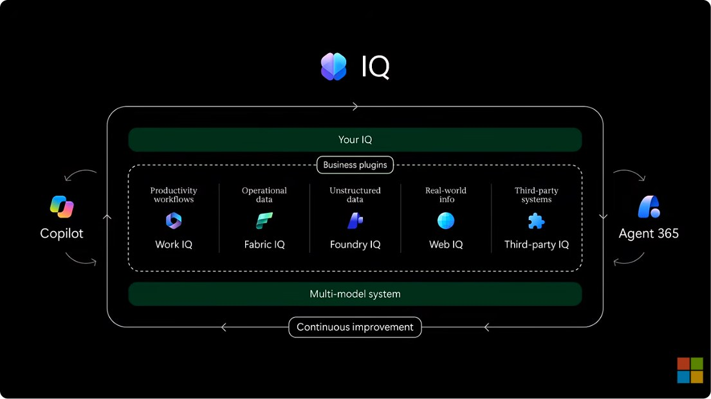
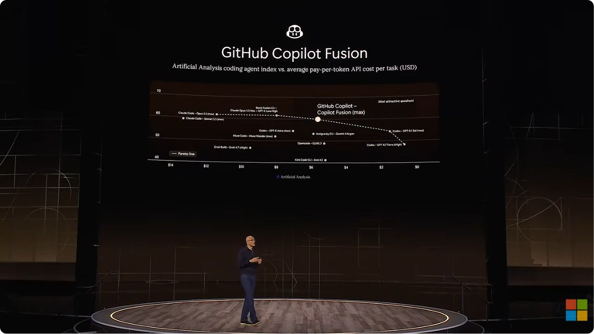
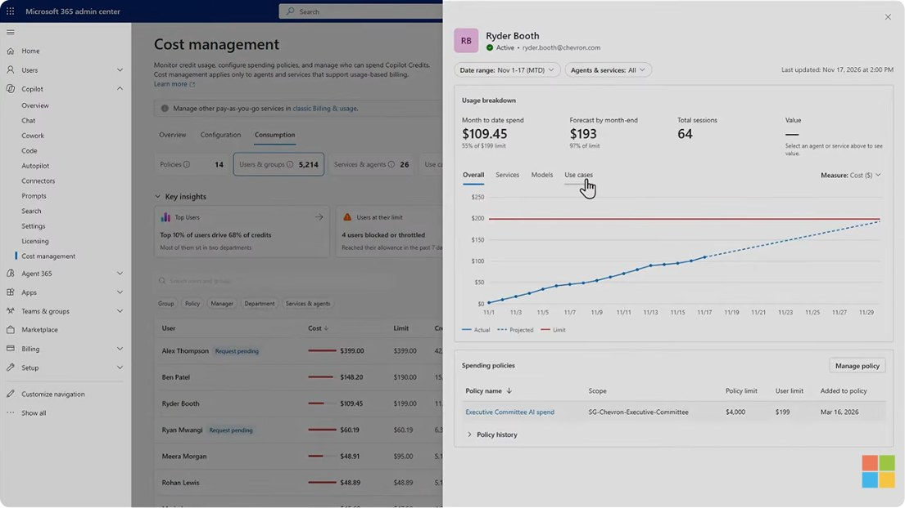
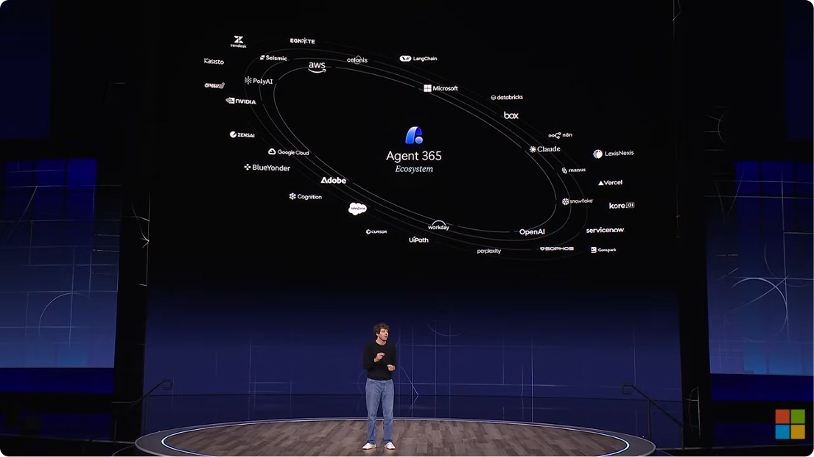
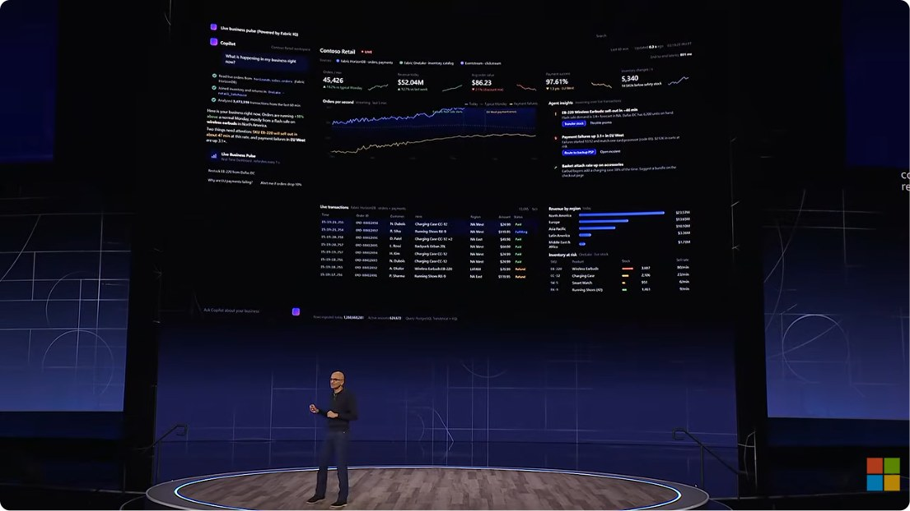
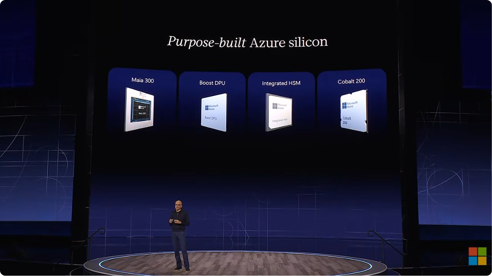

Microsoft Ignite 2026 오프닝 키노트(약 2시간 25분)의 주요 발표를 발표 순서가 아닌 주제별로 정리합니다. 원본 영상은 아래에서 확인할 수 있습니다.

## 1. 키노트의 핵심 메시지: Frontier Ecosystem

키노트 전반의 주제는 **Frontier Ecosystem**입니다. 개별 모델의 성능보다, 기업이 AI를 조직 전체에서 활용하기 위해 필요한 요소를 다음 세 가지로 구분하여 설명하였습니다.

| 구분 | 내용 |
|---|---|
| Human ambition | AI는 사람의 의도와 판단을 확장하는 수단이며, 일의 레버리지가 이동하더라도 전문성의 가치는 유지됩니다. |
| Intelligence | 기업이 자신의 지식과 학습 결과를 직접 축적하고 소유해야 하며, 지능이 소수 모델에 집중되는 구조는 바람직하지 않습니다. |
| Trust | 모델 내부를 완전히 이해하기 어려우므로, 지능의 공급과 그에 대한 통제 권한을 아키텍처 차원에서 분리해야 합니다. |

이후 발표 내용은 대부분 위 세 가지 중 하나에 대응됩니다.

## 2. Microsoft 365 Copilot

### 업무용 운영체제로서의 Copilot

Microsoft는 Copilot을 채팅, 코워커, 코드 기능이 통합된 **업무용 운영체제**로 정의하였습니다. 지식 업무, 코딩, 업무 프로세스 애플리케이션이 모두 Copilot의 플러그인 형태로 연결되는 구조입니다.

주요 구성 요소는 다음과 같습니다.

- **Home**: 단순 질의부터 다단계 작업까지 시작할 수 있는 단일 진입점입니다.
- **Code**: 자연어 설명을 바탕으로 앱, 트래커, 대시보드를 생성합니다. 샌드박스 환경 또는 테넌트 내부에서 안전하게 호스팅됩니다.
- **Autopilot**: 자체 메모리, 메일, 컴퓨터를 갖춘 장시간 실행형 에이전트입니다. 채널을 모니터링하고 반복 업무를 지속적으로 수행하며, 레거시 애플리케이션도 사용할 수 있습니다.
- **Workspaces**: 사람과 에이전트가 공유 컨텍스트를 기반으로 동일한 목표를 향해 협업하는 공간입니다.
- **Today**: 메일, 일정, Teams, 회의, 작업을 종합하여 우선순위가 높은 항목을 제시하고, 답장 초안과 일정 변경안을 미리 준비합니다.

발표에서는 Home, Code, Office 통합이 현재 사용 가능하며, Today, Autopilot, Workspaces는 향후 수 주에 걸쳐 순차적으로 제공될 예정이라고 안내하였습니다.

### Office 기능의 Copilot 통합

Word, Excel, PowerPoint의 전체 기능이 Copilot 내에서 제공됩니다. Word의 변경 내용 추적, Excel의 고급 수식, 팀원 멘션이 지원되며, 파일은 테넌트 내에 그대로 보관되어 민감도 레이블과 규정 준수 정책이 유지됩니다. 또한 Office 기능은 Copilot 구독에 포함되어 있어, 문서 초안 작성에 별도의 종량 과금이 발생하지 않는다고 설명하였습니다.

### 고객 및 내부 사례

| 사례 | 내용 |
|---|---|
| Microsoft 내부 시연 | 일요일 약 2시간 동안 Copilot으로 발표 아웃라인, 프레젠테이션, 고객 트래커(Excel), 3D 데모를 제작하였으며, 사용량은 약 10,000 크레딧(약 100달러)이었습니다. |
| Chevron | 엔지니어링 설계 기준서(Basis of Design) 작성을 수개월에서 수분 수준으로 단축하였습니다. 해당 세션의 사용량은 약 4,500 크레딧(약 45달러)이었으며, 작업 과정을 재사용 가능한 스킬로 저장하였습니다. |
| BlackRock | Dynamics 365 데이터를 기반으로 목표 달성률(73%)과 파이프라인 커버리지(목표 3배 대비 2.2배)를 분석하고, 고객별 제안 패키지를 생성하였습니다. 모든 발송은 담당 RM의 승인 후 이루어집니다. |

### Salesforce 및 Dynamics 365 연동

Dynamics 365용 비즈니스 플러그인과 함께, Salesforce와의 협력 사항 세 가지가 발표되었습니다.

1. Copilot용 Salesforce 세일즈 플러그인
2. Teams 내 Salesforce 연동(**Copilotforce**)
3. Fabric과 Salesforce Data 360 간 제로카피(zero-copy) 통합

Accenture가 디자인 파트너로 참여하여 영업 조직에 적용하는 사례가 소개되었습니다.

## 3. Microsoft IQ

Microsoft는 Work IQ, Fabric IQ, Foundry IQ를 통합한 **Microsoft IQ**를 출시하였습니다. 기업의 데이터와 업무 컨텍스트를 한곳에서 관리하고, 이를 여러 에이전트가 일관되게 활용하도록 하는 엔터프라이즈 컨텍스트 관리 플랫폼입니다.

| 구성 요소 | 역할 |
|---|---|
| Work IQ | Teams 대화, 메일, 문서 등 협업 데이터 |
| Fabric IQ | 사전에 정의된 비즈니스 지표. Azure 외에 AWS, Snowflake 데이터도 연결 |
| Foundry IQ | 기술 매뉴얼, 사례 등 지식 베이스 |
| Web IQ | 웹 정보 및 규제 문서 |

350개 이상의 커넥터를 제공하며, Copilot과 Foundry는 물론 ChatGPT, Claude 등 외부 어시스턴트에서도 사용할 수 있는 개방형 구조입니다. 발표에서는 이 컨텍스트가 기업의 지적 재산이며, 그 가치가 기업 자체에 축적되어야 한다는 점이 반복적으로 강조되었습니다.

**Unilever 사례**: 클레임 처리 에이전트가 청구 금액의 불일치(한 건당 2,000달러 이상)를 탐지하고, 과거 유사 사례 4건과 의사결정자를 함께 제시하였습니다. 담당자의 판단은 IQ에 기록되어 이후 동일 유형의 건에 재활용되며, 해당 건에서 약 12,000달러의 가치를 보호하였다고 설명하였습니다.

## 4. 모델 라인업

Microsoft는 단일 모델이 아니라 작업별로 최적의 지능을 경제적으로 매핑하는 **멀티모델 시스템**을 강조하였습니다.

**Foundry 제공 모델**

- GPT-6.2: 전작 대비 낮은 비용으로 복합 전문 업무 벤치마크에서 우수한 성능을 보였다고 소개되었습니다.
- Claude 5.2: 직전 주에 제공되었습니다.
- Meta 최신 모델: 추가 제공 예정입니다.

**Microsoft 자체 모델(MAI)**

- **Decision 1.1**: 정식 출시(GA)되었습니다. 소프트웨어 내부에 판단 기능을 내장하기 위한 모델로, 4,000개 이상의 고객이 사용하였으며 LLM 대비 10배 이상 빠르고 200배 저렴하다고 발표되었습니다. Copilot의 모드·모델 라우팅에도 사용됩니다.
- **Code 2 / Code 2 Flash**: 엔터프라이즈 코딩용 플래그십 모델과, 고빈도 작업에 적합한 경량 모델입니다.
- **Cyber Flash**: 보안 작업용 경량 모델입니다.
- **MAI 라이선스 가중치**: 신뢰할 수 있는 파트너에게 모델 가중치를 제공하는 계획이 발표되었습니다.

**GitHub Copilot Fusion**

여러 모델을 오케스트레이션하여 프런티어급 결과를 낮은 비용으로 제공하는 기능입니다. Terminal Bench의 코딩 에이전트 부문에서 1위를 기록하였으며, 비용은 절반 이하라고 소개되었습니다.

Foundry에서는 Copilot과 GitHub Copilot에 사용되는 관리형 에이전트 하네스를 제공하며, 사용자가 정의한 벤치마크와 평가를 기준으로 운영 환경에서 에이전트가 지속적으로 개선되는 구조를 지원합니다.

## 5. AI 비용 관리: Agent 365 Business Analytics

데모 전반에서 작업별 비용이 함께 제시되었습니다. 신규 발표된 **Agent 365 Business Analytics**는 AI 사용량을 ERP와 같이 관리하는 기능으로 설명되었습니다.

- **비용 파악**: 서비스, 에이전트, 모델, 사용자별로 비용 발생 요인을 확인합니다.
- **가치 연결**: 특정 작업과 업무에서 AI 활용의 가치를 측정합니다.
- **ROI 최적화**: 비용 시나리오 예측과 차지백을 지원합니다.

IT 관리자는 Cowork 사용 전에 지출 한도를 설정할 수 있으며, 한도에 도달하면 사용자가 증액을 요청하는 방식으로 운영됩니다. 현재는 Frontier 공개 프리뷰 상태이며, 위임된 지출 정책과 Microsoft 외 에이전트의 비용 가시성은 12월에 제공될 예정입니다.

## 6. 에이전트 관리와 보안

### Agent 365

Agent 365는 기존의 거버넌스, 아이덴티티, 보안, 관리 체계를 에이전트까지 확장하는 컨트롤 플레인입니다. 에이전트, 플러그인, 스킬을 레지스트리로 관리하고 정책을 적용할 수 있으며, Microsoft 외에 AWS, OpenAI, Anthropic, Databricks, Snowflake, Salesforce 등 다른 플랫폼의 에이전트도 관리 대상에 포함합니다.

보안 측면에서는 임직원 기기에서 실행되는 로컬 에이전트의 탐지, 위험도 평가, 비준수 에이전트 차단 기능이 소개되었습니다.

### Microsoft Perception

AI를 활용한 공격이 증가하는 상황에서, 발표에서는 다음과 같은 변화가 제시되었습니다.

- 이번 달 보안 패치에서 처리한 취약점은 1,000건 이상으로, 3월의 100건 미만 대비 약 10배 증가하였습니다.
- 고품질 취약점 발견 비용이 약 30만 달러에서 5달러 미만으로 낮아졌습니다.
- 취약점 발견에서 악용까지 걸리는 시간이 0에 가까워지고 있습니다.

이에 대응하는 에이전트 기반 보안 시스템 **Microsoft Perception**이 정식 출시(GA)되었습니다. Defender, Entra, Purview, Sentinel을 센서로 활용하고, 일일 1,650억 건 이상의 시그널을 위협 인텔리전스와 결합하여 에이전트가 활용할 보안 컨텍스트를 구성합니다.

| 에이전트 | 역할 |
|---|---|
| Blue team | 위협 헌팅, 탐지, 조사 |
| Red team | 공격 모사 및 노출 지점 분석 |
| Green team | 보안 자세 개선, 코드 수정, 탐지 규칙 작성 등 복구 |

여러 에이전트를 **플레이북**으로 구성하여 실행 조건과 예상 비용을 사전에 설정할 수 있고, 실행 결과와 비용은 FinOps 대시보드와 Agent 365에서 확인할 수 있습니다. 시연에서는 활발히 악용되는 취약점이 포함된 패치를 대상으로 약 52,000대의 장치와 15,000개의 CVE를 하나의 시스템에서 분석하였습니다. 또한 MAI Cyber 2가 작업당 비용 2% 수준에서 GPT-6 Astra보다 우수한 방어 성능을 보였다고 소개되었습니다.

### AI 투명성 이니셔티브

모델이 스스로에 대해 설명하는 내용은 독립적인 증거가 될 수 없고, 한 모델이 다른 모델을 감시하는 방식에도 같은 한계가 있다는 문제 인식에서 출발한 이니셔티브입니다.

1. 투명성, 보안, 거버넌스에 관한 업계 표준 수립에 협력합니다.
2. 모델과 제공자에 관계없이 독립적으로 검증 가능한 AI를 지향하는 생태계 접근을 취하며, 현재 40개 조직이 참여하고 있습니다.
3. 동일한 표준을 Microsoft의 모델과 제품(Copilot 포함)에 적용합니다.

## 7. 인프라

### 에이전트 워크로드를 위한 아키텍처

GitHub는 에이전트로 인한 푸시, 액션, PR 증가에 대응하여 아키텍처를 재설계하였고, 단일 저장소에 5,000개 에이전트를 연결한 상태에서 초당 7,200회 쓰기(기존 대비 180배)를 유지하였다고 소개되었습니다. 이 접근을 Azure 전반으로 확대할 계획입니다.

### HorizonDB와 Fabric 통합

에이전트 환경을 위한 분산 관리형 SQL 데이터베이스 **HorizonDB**가 Azure에서 정식 출시되었으며, 8배 빠른 성능이 언급되었습니다. 이를 Fabric에 통합하여 트랜잭션 데이터와 분석 데이터를 하나로 통합하고, 에이전트가 실시간 트랜잭션과 과거 데이터를 함께 분석할 수 있도록 하였습니다. 시연에서는 Copilot이 현재 비즈니스 상황을 실시간 대시보드로 구성하였습니다.

### 하드웨어와 인프라 현황

자체 실리콘으로 Maia 300, Boost DPU, Integrated HSM, Cobalt 200이 소개되었고, Maia 300은 와트당 토큰 처리량이 40% 높다고 설명되었습니다.

그 밖에 500개 이상의 데이터센터와 80개 Azure 리전, 연간 전력 사용량 100% 재생에너지 매칭, 서버 및 부품 92% 재사용·재활용, 소버린 클라우드 옵션, Windows 기반 로컬 모델 실행(무과금 인텔리전스) 등이 언급되었습니다.

## 정리

이번 키노트의 발표 내용은 다음 세 가지 축으로 요약할 수 있습니다.

- **일하는 방식**: Copilot(Home, Code, Autopilot, Workspaces, Today)을 업무 운영체제로 확장합니다.
- **지능의 소유**: Microsoft IQ를 통해 조직의 데이터, 지식, 의사결정 이력을 에이전트가 활용할 수 있는 자산으로 관리합니다.
- **비용과 보안의 통제**: Agent 365와 Perception으로 에이전트의 비용, 거버넌스, 보안을 통합 관리합니다.

도입을 검토하시는 경우 다음 사항을 우선 점검하시기를 권장합니다.

1. 현재 AI 사용량을 사용자, 작업, 모델 단위로 파악할 수 있는지 확인합니다.
2. Microsoft IQ 활용을 위해 사내 문서와 데이터의 권한 구조를 점검합니다.
3. 조직 내 에이전트(개인 기기의 로컬 에이전트 포함) 현황을 파악합니다.
4. 기존에 사용 중인 타사 플랫폼과의 연동 범위를 검토합니다.

> 본 글은 Microsoft Ignite 2026 오프닝 키노트 영상의 자막을 기준으로 작성하였습니다. 제품명, 수치, 제공 시점은 Microsoft 공식 발표와 Ignite 세션 자료를 통해 확인하시기 바랍니다. 이미지는 키노트 영상 화면이며 저작권은 Microsoft에 있습니다.
