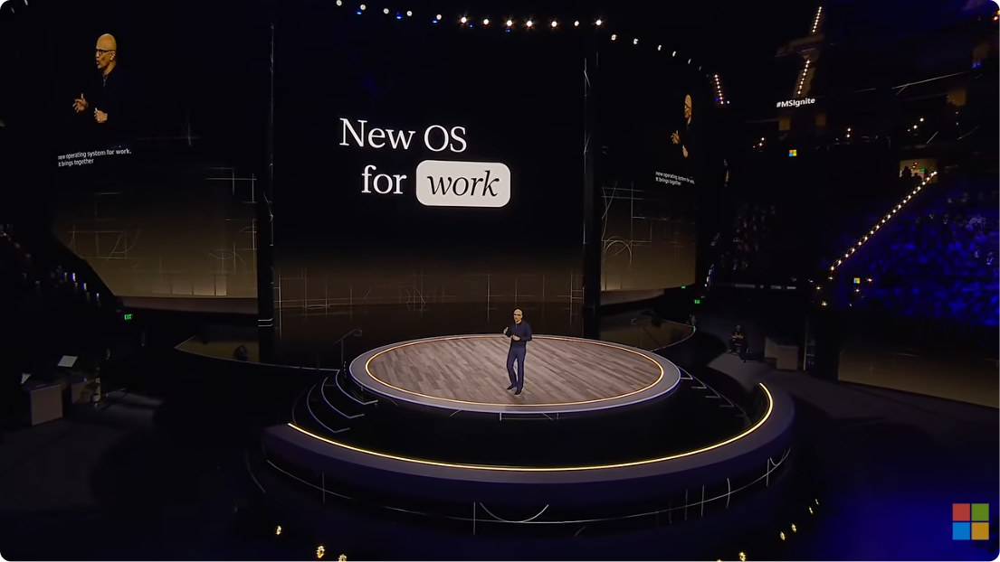
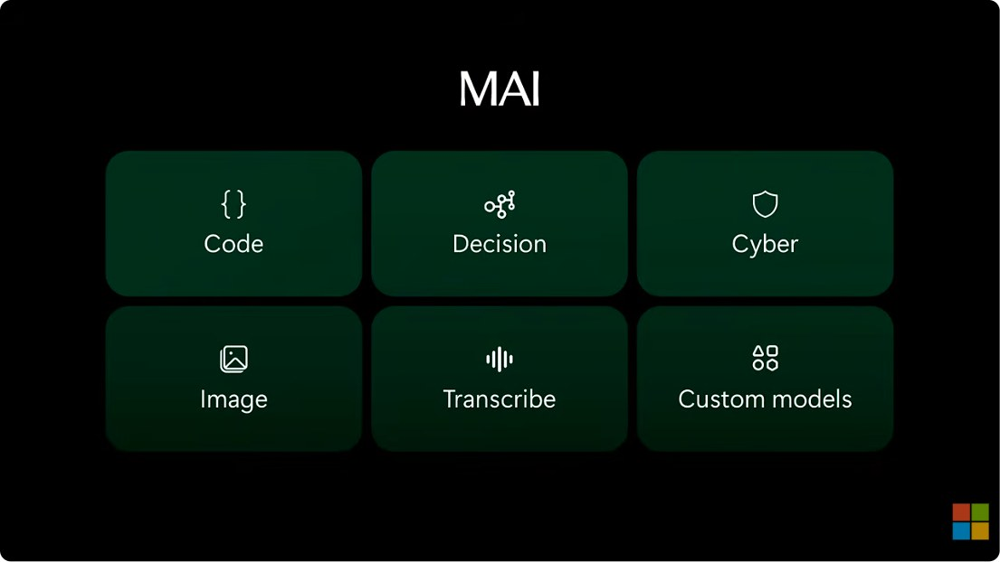

Microsoft Ignite 2026 오프닝 키노트(약 2시간 25분)의 주요 발표를 발표 순서가 아닌 주제별로 정리합니다. 원본 영상은 아래에서 확인할 수 있습니다.

> **먼저 알아두면 좋은 용어**
> - **에이전트**: 사람이 일일이 시키지 않아도 목표를 받아 스스로 일을 진행하는 AI입니다.
> - **플러그인**: Copilot에 붙여서 쓰는 추가 기능입니다. 예를 들어 영업 시스템을 연결하면 Copilot이 영업 업무를 도와줍니다.
> - **크레딧**: AI를 쓴 만큼 차감되는 사용량 단위입니다. 이 글의 예시에서는 10,000 크레딧이 약 100달러입니다.

## 1. 키노트의 핵심 메시지: Frontier Ecosystem

키노트 전체를 관통하는 말은 **Frontier Ecosystem**입니다. 성능 좋은 AI 모델 하나만으로는 부족하고, 기업이 AI를 제대로 쓰려면 아래 세 가지가 함께 갖춰져야 한다는 뜻입니다.

| 구분 | 쉽게 말하면 |
|---|---|
| Human ambition (사람) | AI는 사람을 대신하는 것이 아니라 사람이 하려는 일을 더 크게 해주는 도구입니다. 일하는 방식은 달라져도 사람의 경험과 전문성은 여전히 중요합니다. |
| Intelligence (지능) | 기업이 자신만의 지식과 노하우를 직접 쌓고 소유해야 합니다. 몇몇 AI 모델에만 모든 것을 맡기면 기업의 경쟁력이 사라질 수 있다고 보았습니다. |
| Trust (신뢰) | AI가 내부에서 어떻게 판단하는지는 완전히 알기 어렵습니다. 그래서 AI가 "문제없다"고 말하는 것을 믿는 대신, 회사가 AI에게 줄 권한을 직접 정하고, 한 일을 기록하고, 문제가 생기면 멈출 수 있어야 합니다. 사람 직원에게 출입 권한을 주고 업무 기록을 남기는 것과 비슷합니다. |

이후 발표는 대부분 위 세 가지 중 하나에 해당합니다.

## 2. Microsoft 365 Copilot

### Copilot은 "업무용 운영체제"

Microsoft는 Copilot을 단순한 채팅 도구가 아니라, 문서 작성, 코딩, 업무 시스템 사용을 한곳에서 처리하는 **업무용 운영체제**라고 설명했습니다. PC의 운영체제 위에서 여러 앱이 돌아가듯, Copilot 위에서 여러 업무 앱이 플러그인 형태로 동작한다는 의미입니다.

주요 기능은 다음과 같습니다.

- **Home**: 간단한 질문부터 여러 단계가 필요한 작업까지 모두 여기서 시작합니다.
- **Code**: 만들고 싶은 것을 말로 설명하면 앱, 업무 관리표, 대시보드를 만들어 줍니다. 회사 보안 환경 안에서 안전하게 실행됩니다.
- **Autopilot**: 사람처럼 자기 메일과 기억을 가지고 오래 일하는 에이전트입니다. 팀 채널을 지켜보다가 반복 업무를 처리하고, 오래된 업무 시스템도 사용할 수 있습니다.
- **Workspaces**: 사람과 에이전트가 같은 자료를 보면서 하나의 목표를 위해 함께 일하는 공간입니다.
- **Today**: 메일, 일정, Teams, 회의를 훑어서 지금 봐야 할 일을 보여 주고, 답장 초안과 일정 조정안도 미리 만들어 둡니다.

Home, Code, Office 통합은 지금 사용할 수 있고, Today, Autopilot, Workspaces는 앞으로 몇 주에 걸쳐 차례로 제공될 예정이라고 합니다.

### Office 기능이 Copilot 안으로

Word, Excel, PowerPoint의 기능을 Copilot 안에서 그대로 사용할 수 있습니다. Word의 변경 내용 추적, Excel의 고급 수식, 동료 멘션도 지원합니다. 파일은 회사 환경에 그대로 저장되므로 문서에 설정한 보안 등급과 회사 규정도 그대로 적용됩니다. 또한 이 기능은 Copilot 구독에 포함되어 있어서, 문서 초안을 만들 때 사용량에 따른 추가 요금이 붙지 않는다고 합니다.

### 고객 및 내부 사례

| 사례 | 내용 |
|---|---|
| Microsoft 내부 시연 | 일요일 약 2시간 동안 Copilot으로 발표 개요, 발표 자료, 고객 현황 엑셀 표, 3D 데모까지 만들었습니다. 사용량은 약 10,000 크레딧(약 100달러)이었습니다. |
| Chevron | 엔지니어링 설계 기준 문서(Basis of Design) 작성을 몇 달에서 몇 분으로 줄였습니다. 이 작업의 사용량은 약 4,500 크레딧(약 45달러)이었고, 작업 방법을 저장해 다른 엔지니어도 같은 방식으로 쓸 수 있게 했습니다. |
| BlackRock | Dynamics 365의 영업 데이터를 분석해 목표 달성률(73%)과 영업 기회 확보 수준(목표 3배 대비 2.2배)을 짚어냈고, 고객별 제안 자료를 만들었습니다. 고객에게 나가는 모든 메일은 담당자의 승인을 거칩니다. |

### Salesforce와 Dynamics 365 연동

Dynamics 365용 플러그인과 함께, Salesforce와의 협력도 세 가지 발표되었습니다.

1. Copilot에서 쓰는 Salesforce 영업 플러그인
2. Teams 안에서 Salesforce를 사용하는 기능(**Copilotforce**)
3. Fabric과 Salesforce Data 360 연결. 데이터를 복사하지 않고 원래 위치에 둔 채로 바로 읽어 쓰는 방식(제로카피)입니다.

Accenture가 개발 단계부터 참여해 자사 영업 조직에 적용하는 사례도 소개되었습니다.

## 3. Microsoft IQ

Microsoft는 Work IQ, Fabric IQ, Foundry IQ를 하나로 묶은 **Microsoft IQ**를 출시했습니다. 회사의 데이터와 업무 지식을 한곳에 모아 두고, 여러 에이전트가 같은 정보를 보고 일하게 해주는 서비스입니다.

| 구성 요소 | 담고 있는 것 |
|---|---|
| Work IQ | Teams 대화, 메일, 문서 등 사람들이 함께 일한 기록 |
| Fabric IQ | 회사가 이미 정해 둔 업무 지표. Azure뿐 아니라 AWS, Snowflake의 데이터도 연결할 수 있음 |
| Foundry IQ | 기술 매뉴얼, 사례 등 회사의 지식 자료 |
| Web IQ | 웹 정보와 관련 규정 문서 |

다른 서비스와 연결하는 기능(커넥터)이 350개 이상이고, Copilot과 Foundry뿐 아니라 ChatGPT, Claude 같은 다른 AI 서비스에서도 쓸 수 있습니다. 발표에서는 이 정보가 회사의 소중한 자산이므로, 그 가치가 Microsoft나 AI 회사가 아니라 고객 회사에 쌓여야 한다는 점을 반복해서 강조했습니다.

**Unilever 사례**: 클레임(보상 요청) 처리 에이전트가 청구 금액이 맞지 않는 건(한 건에서 2,000달러 이상 차이)을 찾아냈습니다. 그리고 과거에 비슷했던 4건과 당시 판단한 담당자를 함께 보여 주었습니다. 담당자가 내린 판단은 IQ에 저장되어 다음에 비슷한 건이 생기면 에이전트가 참고합니다. 이 건에서만 약 12,000달러를 아꼈다고 합니다.

## 4. 모델 라인업

Microsoft는 가장 좋은 모델 하나를 쓰기보다, **일의 종류에 따라 알맞은 모델을 골라 쓰는 방식**이 효율적이라고 설명했습니다. 어려운 일에는 고성능 모델을, 간단한 일에는 빠르고 저렴한 모델을 쓰는 식입니다.

**Foundry에서 제공하는 외부 모델**

- GPT-6.2: 이전 모델보다 비용은 낮고, 전문 업무 평가에서는 더 좋은 성적을 냈다고 소개되었습니다.
- Claude 5.2: 직전 주에 제공이 시작되었습니다.
- Meta 최신 모델: 추가로 제공될 예정입니다.

**Microsoft가 만든 모델(MAI)**

- **Decision 1.1**: 정식 출시되었습니다. 소프트웨어 안에서 "이 요청은 어디로 보낼까", "이 의견은 어떤 종류일까"처럼 빠르게 판단해야 할 때 쓰는 모델입니다. 4,000개 이상의 고객이 써 보았고, 일반 대형 언어 모델보다 10배 이상 빠르고 200배 저렴하다고 합니다. Copilot도 어떤 모델로 처리할지 고를 때 이 모델을 씁니다.
- **Code 2 / Code 2 Flash**: 업무용 코딩에 쓰는 대표 모델과, 간단한 작업을 빠르게 처리하는 가벼운 모델입니다.
- **Cyber Flash**: 보안 작업에 쓰는 가벼운 모델입니다.
- **MAI 라이선스 가중치**: 믿을 수 있는 파트너에게 모델의 핵심 데이터(가중치)를 제공해서, 파트너가 직접 운영할 수 있게 하는 계획입니다.

**GitHub Copilot Fusion**

여러 모델을 함께 사용해서 최고 수준의 결과를 더 낮은 비용으로 내는 기능입니다. 코딩 에이전트 성능 평가(Terminal Bench)에서 1위를 했고, 비용은 절반 이하라고 소개되었습니다.

Foundry에서는 Copilot과 GitHub Copilot이 실제로 사용하는 에이전트 실행 환경을 그대로 제공합니다. 회사가 직접 평가 기준을 정해 두면, 에이전트가 실제로 일하면서 그 기준에 맞춰 점점 나아지도록 만들 수 있습니다.

## 5. AI 비용 관리: Agent 365 Business Analytics

이번 키노트에서는 데모마다 "이 작업에 비용이 얼마 들었는지"를 함께 보여주었습니다. 새로 발표된 **Agent 365 Business Analytics**는 회사에서 AI를 얼마나, 어디에 썼는지를 한눈에 보여주는 기능입니다. 회사의 돈 관리 시스템(ERP)처럼 AI 사용량을 관리한다고 보면 됩니다.

- **비용 확인**: 어떤 서비스, 에이전트, 모델, 사용자가 비용을 많이 쓰는지 볼 수 있습니다.
- **효과 확인**: 특정 업무에서 AI가 어떤 가치를 만들었는지 측정합니다.
- **예산 계획**: 앞으로의 비용을 예측하고, 부서별로 비용을 나누어 청구하는 것까지 지원합니다.

IT 관리자는 Cowork를 쓰기 전에 사용 한도를 먼저 정할 수 있습니다. 한도에 도달하면 사용자가 추가 사용을 요청해야 합니다. 지금은 Frontier 공개 프리뷰(일부 고객에게 먼저 공개하는 단계)이고, 부서별 지출 한도 위임 기능과 Microsoft 외 에이전트의 비용 확인 기능은 12월에 제공될 예정입니다.

## 6. 에이전트 관리와 보안

### Agent 365

Agent 365는 회사가 직원에게 하던 계정 관리, 접근 권한 관리, 보안 점검을 **에이전트에게도 똑같이 적용**하는 관리 서비스입니다. 회사에서 쓰는 에이전트, 플러그인, 스킬을 한곳에 등록해 두고 규칙을 정할 수 있습니다. Microsoft 제품뿐 아니라 AWS, OpenAI, Anthropic, Databricks, Snowflake, Salesforce 등 다른 회사 플랫폼의 에이전트도 함께 관리할 수 있습니다.

보안 면에서는 직원 PC에서 개인적으로 실행되는 에이전트를 찾아내고, 위험도를 평가하며, 회사 규정에 맞지 않으면 차단하는 기능이 소개되었습니다.

### Microsoft Perception

AI를 이용한 공격이 늘고 있다는 점이 먼저 지적되었습니다.

- 이번 달 보안 업데이트에서 처리한 보안 취약점(해커가 악용할 수 있는 소프트웨어의 결함)이 1,000건이 넘습니다. 3월에는 100건이 안 되었으니 1년도 안 되어 약 10배가 된 셈입니다.
- 쓸 만한 취약점 하나를 찾는 비용은 예전에 약 30만 달러였지만, AI를 쓰면 5달러도 들지 않습니다.
- 취약점이 발견되고 나서 실제로 공격에 쓰이기까지 걸리는 시간이 거의 0에 가까워지고 있습니다.

이에 대응하는 **Microsoft Perception**이 정식 출시되었습니다. 에이전트가 직접 보안 업무를 하는 시스템입니다. Defender, Entra, Purview, Sentinel 같은 기존 보안 제품에서 매일 1,650억 건이 넘는 보안 신호를 모으고, 여기에 위협 정보를 더해 에이전트가 판단할 수 있는 형태로 정리합니다.

보안팀의 역할을 에이전트가 나누어 맡습니다.

| 에이전트 | 하는 일 |
|---|---|
| Blue team | 위협을 찾아내고 조사합니다. |
| Red team | 해커처럼 공격해 보면서 허점을 먼저 찾아냅니다. |
| Green team | 허점을 고치고, 보안 설정과 코드를 개선하며, 탐지 규칙을 만듭니다. |

여러 에이전트를 묶어 **플레이북**(업무 순서를 정해 둔 계획서)으로 만들 수 있습니다. 언제 실행할지, 비용이 얼마나 들지 미리 정해 두고, 결과와 비용은 Agent 365에서 확인합니다. 시연에서는 실제로 공격에 악용되고 있는 취약점이 포함된 보안 업데이트를 대상으로, 약 52,000대의 장비와 15,000개의 취약점(CVE, 취약점 고유 번호)을 한 화면에서 분석했습니다. 또한 Microsoft의 보안 모델 MAI Cyber 2는 GPT-6 Astra보다 방어 성능이 좋으면서 비용은 작업당 2% 수준이라고 소개되었습니다.

### AI 투명성 이니셔티브

AI 모델이 자기 자신에 대해 설명하는 내용은 믿을 만한 증거가 될 수 없습니다. 그렇다고 다른 AI 모델이 감시하게 해도 똑같은 한계가 있습니다. 이 문제를 풀기 위해 Microsoft는 **AI 투명성 이니셔티브**를 시작했습니다.

1. AI의 투명성, 보안, 관리 방식에 대한 업계 공통 기준을 만드는 데 협력합니다.
2. 어느 회사의 모델이든 외부에서 독립적으로 확인할 수 있게 하는 것을 목표로 하며, 현재 40개 조직이 함께합니다.
3. 같은 기준을 Microsoft의 AI 모델과 Copilot을 포함한 모든 제품에 적용합니다.

## 7. 인프라

### 에이전트가 많아져도 버티는 구조

GitHub는 에이전트 때문에 코드 저장, 자동 작업 실행, 코드 검토 요청이 크게 늘자 내부 구조를 다시 설계했습니다. 그 결과, 하나의 저장소에 에이전트 5,000개를 동시에 연결해도 초당 7,200번 저장하는 속도를 유지했고, 이는 기존보다 180배 많은 양입니다. Microsoft는 이 방식을 Azure 전체로 넓힐 계획입니다.

### HorizonDB와 Fabric 통합

**HorizonDB**는 에이전트 환경을 위해 만든 데이터베이스로, Azure에서 정식 출시되었고 속도는 8배 빠르다고 합니다. 이 데이터베이스를 Fabric에 통합해서, 지금까지 따로 관리하던 주문·결제 같은 실시간 업무 데이터와 분석용 데이터를 한곳에서 볼 수 있게 했습니다. 에이전트는 지금 들어오는 주문과 과거 기록을 함께 보고 판단할 수 있습니다. 시연에서는 Copilot에게 "지금 우리 비즈니스에서 무슨 일이 일어나고 있어?"라고 묻자 실시간 현황 대시보드를 만들어 주었습니다.

### 하드웨어와 데이터센터

Microsoft가 직접 설계한 칩으로 Maia 300, Boost DPU, Integrated HSM, Cobalt 200이 소개되었습니다. 이 중 Maia 300은 같은 전력으로 처리하는 AI 연산량이 40% 더 많다고 합니다.

그 밖에 다음 내용이 언급되었습니다.

- 데이터센터 500개 이상, Azure 리전(서비스 지역) 80개
- 연간 전력 사용량 전체를 재생에너지로 맞춤
- 서버와 부품의 92%를 재사용하거나 재활용
- 국가나 기업이 데이터를 자기 통제 아래 두고 싶을 때 쓰는 소버린 클라우드 옵션
- PC에서 AI 모델을 직접 실행해, 사용량에 따른 비용 없이 쓰는 방식

## 정리

이번 키노트의 내용은 세 가지로 요약할 수 있습니다.

- **일하는 방식**: Copilot(Home, Code, Autopilot, Workspaces, Today)이 업무의 중심이 됩니다.
- **우리 회사의 지식**: Microsoft IQ에 회사의 데이터, 지식, 과거 판단 기록을 모아서 에이전트가 활용합니다.
- **비용과 보안 관리**: Agent 365와 Perception으로 에이전트의 비용, 권한, 보안을 한곳에서 관리합니다.

도입을 검토하신다면 다음 네 가지를 먼저 점검해 보시기를 권합니다.

1. 지금 쓰고 있는 AI의 사용량을 사용자, 업무, 모델별로 확인할 수 있는지 살펴봅니다.
2. Microsoft IQ를 쓰려면 문서와 데이터의 접근 권한이 정리되어 있어야 하므로, 사내 문서의 권한 구조를 점검합니다.
3. 회사 안에서 어떤 에이전트가 쓰이고 있는지, 개인 PC에서 돌아가는 에이전트까지 포함해 파악합니다.
4. 이미 쓰고 있는 다른 회사 서비스와 어디까지 연결되는지 확인합니다.

> 본 글은 Microsoft Ignite 2026 오프닝 키노트 영상의 자막을 기준으로 작성하였습니다. 제품명, 수치, 제공 시점은 Microsoft 공식 발표와 Ignite 세션 자료를 통해 확인하시기 바랍니다. 이미지는 키노트 영상 화면이며 저작권은 Microsoft에 있습니다.
